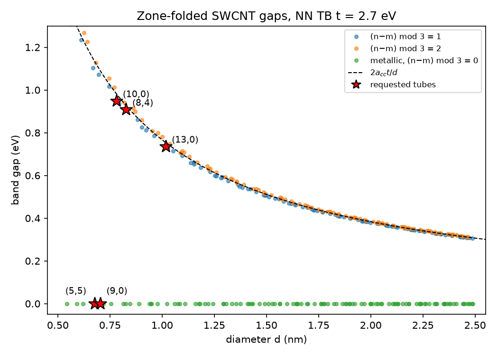

# Dirac cones, Fermi velocity and nanotube gaps from a nearest-neighbour tight-binding model of graphene

*Research question: Oriphim held-out test set. Computation, analysis and drafting: Ori (Oriphim), with an independent review.*

## Abstract

We build the textbook nearest-neighbour tight-binding model of graphene's π electrons (hopping $t = 2.7$ eV, C–C distance $a_{cc} = 1.42$ Å) and use it to (i) locate the Dirac points numerically, (ii) extract the Fermi velocity, (iii) compute the density of states, (iv) fold the graphene bands into five carbon nanotubes, (5,5), (9,0), (10,0), (8,4) and (13,0), and (v) add next-nearest-neighbour hopping $t'$ and a sublattice mass $\Delta$. The Dirac points are found at the Brillouin-zone corners, where the band splitting is {{results/summary.json:dirac_points.0.E_c_minus_E_v_eV|.0e}} eV. The Fermi velocity is {{results/summary.json:fermi_velocity.per_dirac_point.dirac_0.v_mean_m_s|,.0f}} m/s, isotropic to {{results/summary.json:fermi_velocity.per_dirac_point.dirac_0.rel_anisotropy|.0e}}. (5,5) and (9,0) come out metallic. (10,0), (8,4) and (13,0) are semiconducting with gaps of {{results/summary.json:tubes.2.gap_eV|.3f}}, {{results/summary.json:tubes.3.gap_eV|.3f}} and {{results/summary.json:tubes.4.gap_eV|.3f}} eV. Across all {{results/summary.json:gap_sweep.n_tubes|d}} tubes with diameters of 0.5–2.5 nm, the rule "metallic exactly when $(n-m)$ is divisible by 3" holds without exception. The semiconducting gaps follow $E_g \approx 2a_{cc}t/d$. $t'$ moves the Dirac point to $3t'$ without changing $v_F$, breaks electron–hole symmetry and opens no gap; $\Delta$ opens a gap of exactly $2\Delta$. All of these are properties of the model, which ignores tube curvature and many-body effects.

## 1. Question and why it matters

Graphene is a single sheet of carbon atoms in a honeycomb lattice. Its electrons near the Fermi level behave like massless relativistic particles: energy rises linearly with momentum in "Dirac cones" at the corners of the Brillouin zone. A carbon nanotube is the same sheet rolled into a seamless cylinder. Rolling quantises the momentum around the circumference, so a tube's electronic character depends on how it is rolled, given by the chiral indices $(n,m)$. Depending on those indices, a tube is either a metal or a semiconductor whose gap shrinks with diameter. The simplest model that captures this is nearest-neighbour tight binding. The questions asked here are: where are the Dirac points and how fast are the electrons there; what does the density of states look like; which of five given tubes are metallic and how the gaps scale with diameter; and what two common extensions, $t'$ and $\Delta$, do to the cones. These results set the reference point against which more realistic calculations and experiments are compared.

## 2. Method in brief

The model has one $p_z$ orbital per atom and two atoms (A, B) per cell. Its Hamiltonian is
$H(\mathbf k) = \begin{pmatrix}\Delta & -t f \\ -t f^* & -\Delta\end{pmatrix} - t' g(\mathbf k)$,
where $f$ sums $e^{i\mathbf k\cdot\boldsymbol\delta}$ over the three nearest neighbours and $g = |f|^2-3$ (sign convention of Castro Neto et al., Rev. Mod. Phys. 81, 109 (2009)). The overlap integral and spin are omitted.

- **Dirac points** are found by minimising the band splitting over the zone, without assuming where they are. The Fermi velocity is fitted along 72 directions within $|q| \le 2\times10^{-3}$ Å⁻¹ of each point.
- **DOS** is a histogram over a uniform 3000×3000 k-mesh (0.01 eV bins). It is compared with the closed-form result of Hobson and Nierenberg (1953).
- **Nanotubes** use zone folding. The allowed momenta lie on "cutting lines" through the graphene zone, and the gap is the minimum band separation over all lines. As an independent check, each tube's explicit real-space unit cell ($2N$ atoms) is diagonalised. Tubes count as metallic when the gap is below $10^{-5}$ eV.
- **$t'$ and $\Delta$** take the assumed illustrative values $t' = 0.1t, 0.2t$ and $\Delta = 0.05, 0.10, 0.25$ eV.

The full run (`python run.py`) takes about {{results/summary.json:runtime_s|.0f}} s on a laptop.

## 3. Results

**Graphene.** The two Dirac points lie at the inequivalent zone corners $K, K' = (2\pi/3a_{cc}, \pm 2\pi/3\sqrt3 a_{cc})$, within {{results/summary.json:dirac_points.0.dist_to_analytic_K_or_Kp|.0e}} Å⁻¹ of the analytic positions. The cone slope is $\hbar v_F$ = {{results/summary.json:fermi_velocity.hbar_vF_eV_angstrom|.3f}} eV·Å. This gives $v_F$ = {{results/summary.json:fermi_velocity.per_dirac_point.dirac_0.v_mean_m_s|,.0f}} m/s, against the analytic $3ta_{cc}/2\hbar$ = {{results/summary.json:fermi_velocity.analytic_3t_acc_over_2hbar_m_s|,.0f}} m/s; the two agree to better than $10^{-6}$ (relative). The DOS vanishes linearly at zero energy, with slope {{results/summary.json:dos.low_E_slope_numeric_per_eV2|.4f}} states/eV²/cell/spin. It has van Hove peaks at {{results/summary.json:dos.vhs_peak_energies_eV.0|.2f}} and {{results/summary.json:dos.vhs_peak_energies_eV.1|.2f}} eV ($= \mp t$), and it matches the analytic DOS to {{results/summary.json:dos.max_rel_dev_from_analytic_away_from_vHs|.1%}} per bin for $0.3$ eV $< |E| < 2.9t$, excluding 0.1 eV around the van Hove peaks.

**Nanotubes.** Table 1 lists the five requested tubes.

| $(n,m)$ | diameter (nm) | $(n-m)$ mod 3 | gap (eV) | gap × diameter (eV·nm) |
|---|---|---|---|---|
| (5,5) | {{results/summary.json:tubes.0.d_nm|.3f}} | 0 | {{results/summary.json:tubes.0.gap_eV|.0f}} (metal) | – |
| (9,0) | {{results/summary.json:tubes.1.d_nm|.3f}} | 0 | {{results/summary.json:tubes.1.gap_eV|.0f}} (metal) | – |
| (10,0) | {{results/summary.json:tubes.2.d_nm|.3f}} | 1 | {{results/summary.json:tubes.2.gap_eV|.3f}} | {{results/summary.json:tubes.2.gap_times_d_eV_nm|.3f}} |
| (8,4) | {{results/summary.json:tubes.3.d_nm|.3f}} | 1 | {{results/summary.json:tubes.3.gap_eV|.3f}} | {{results/summary.json:tubes.3.gap_times_d_eV_nm|.3f}} |
| (13,0) | {{results/summary.json:tubes.4.d_nm|.3f}} | 1 | {{results/summary.json:tubes.4.gap_eV|.3f}} | {{results/summary.json:tubes.4.gap_times_d_eV_nm|.3f}} |

*Table 1. Zone-folded tubes ($t = 2.7$ eV). Eigenvalues from the cutting-line and real-space routes agree to about $10^{-14}$ eV; gaps agree to better than $10^{-7}$ eV.*

Figure 1 places these tubes among all {{results/summary.json:gap_sweep.n_tubes|d}} tubes between 0.5 and 2.5 nm. A tube is metallic exactly when a cutting line passes through $K$, which happens exactly when $(n-m)$ mod 3 = 0. The {{results/summary.json:gap_sweep.n_semiconducting|d}} semiconducting tubes have a mean gap × diameter of {{results/summary.json:gap_sweep.gap_times_d_eV_nm_mean|.3f}} eV·nm, ranging from {{results/summary.json:gap_sweep.gap_times_d_min|.3f}} to {{results/summary.json:gap_sweep.gap_times_d_max|.3f}}. The textbook value $2a_{cc}t$ is {{results/summary.json:gap_sweep.ref_2acc_t_eV_nm|.4f}} eV·nm. The spread, and the splitting of the two semiconducting families at small diameter, come from trigonal warping of the graphene bands away from $K$.



**$t'$ and $\Delta$** (Figure 2). With $t'$ the cones survive. The Dirac point moves to $E = 3t'$, $v_F$ is unchanged, and electron–hole symmetry is broken: the valence band widens and the conduction band narrows (left panel). A mass $\Delta$ opens a direct gap of exactly $2\Delta$ at $K$ and $K'$, which turns the cones into massive hyperbolas with band-edge mass given by $\hbar^2/m^* = (\hbar v_F)^2/\Delta - 2t'(1.5a_{cc})^2$ ($m^* = \Delta/v_F^2$ for $t'=0$), valid for $\hbar v_F q \ll \Delta$ (values in `results/summary.json`, key `tp_delta`). The DOS is zero inside the gap. In the tubes, $t'$ leaves every gap unchanged. $\Delta$ gaps the metallic tubes by $2\Delta$, e.g. (5,5) gives {{results/summary.json:tubes_tp_delta.5.gap_eV|.3f}} eV for $\Delta = 0.10$ eV, and raises (10,0) to {{results/summary.json:tubes_tp_delta.7.gap_eV|.3f}} eV $= \sqrt{E_{g0}^2+4\Delta^2}$. These tube results follow exactly from the model, because both bands are monotone in $|f|$; this is exact within zone folding only and would not survive curvature. They are consistency results, not discoveries.


## 4. How it was checked

Before the main run, an independent reviewer (the Sceptic) wrote 44 acceptance checks in `tests/checks/`. These use their own implementation of the graphene and zone-folding formulas, with tube geometry from Saito, Dresselhaus and Dresselhaus (1998), exact zigzag gaps, the analytic DOS, and the exact $t'$/$\Delta$ results. On a 1/8-size pilot, the Sceptic flagged one **suspect** result. The effective mass under $\Delta$ had been fitted over a momentum window too wide compared with $\Delta/\hbar v_F$, and it came out 9 % high for $\Delta = 0.05$ eV. The fit window was narrowed to $q \le 0.02\,\Delta/\hbar v_F$. The masses now agree with the analytic curvature to $2\times10^{-4}$ (both figures from `notes/review.md`). A second pilot failure, the per-bin DOS deviation from the analytic curve, was limited by the mesh and passes at full size ({{results/summary.json:dos.max_rel_dev_from_analytic_away_from_vHs|.1%}}). On the full run, 62 tests were collected. 60 pass (all 18 unit tests and 42 of the 44 checks), 0 fail, and 2 checks are skipped by design (gap × diameter is undefined for metals). Tube gaps converge to $10^{-6}$ eV between the pilot and the full mesh. This check needs the pilot run; without it, pytest reports 59 passed and 3 skipped. The post-run review found no hard-coded results and no remaining suspect findings. It noted the figure display issues mentioned under Figure 2.

## 5. What it does not show

These limits are taken from `LIMITS.md`.

- **Zone folding ignores tube curvature and σ–π hybridisation.** The (9,0) tube is exactly metallic here. A real (9,0) has a small curvature gap of about 80 meV (Ouyang et al., 2001). The gaps of tubes below about 1 nm diameter, such as (10,0) and (8,4), are reduced by hybridisation in reality, so the values here are upper-end tight-binding numbers and not predictions.
- **Single-particle gaps only.** There are no excitons, GW corrections, spin–orbit coupling, strain, substrate or disorder. The overlap integral is omitted, so the nearest-neighbour bands are electron–hole symmetric by construction.
- **$v_F$ follows from the input $t$.** The value of {{results/summary.json:fermi_velocity.per_dirac_point.dirac_0.v_mean_m_s|,.0f}} m/s is the model's own. Measured values are about 1.0–1.1×10⁶ m/s.
- **$t'$ and $\Delta$ are illustrative assumptions.** All the $\Delta$ values exceed the roughly 15–30 meV masses reported for graphene on hBN. The sign of $t'$ is a convention, and only the electron–hole asymmetry is physical. Applying $\Delta$ to tubes is a formal exercise.
- **DOS peak heights depend on the bin width.** Only the positions of the van Hove peaks are meaningful. The metallic/semiconducting rule is verified only for diameters of 0.5–2.5 nm.
- **Effective mass and large $t'$.** $m^*$ describes the band only for $\hbar v_F q \ll \Delta$; beyond that the dispersion is hyperbolic. At $t' = 0.2t$ the conduction-band maximum moves off Γ to a ring, which causes the DOS spike near +5 eV in Figure 2; this is a model artefact. Third-neighbour hopping is omitted.
- **Idealised tubes and limited convergence.** Tubes are infinite and defect-free, with no environment, doping or temperature. Only the k-mesh was varied; the DOS bin width and minimiser tolerances were not.

## 6. Reproduce

```bash
uv venv .venv && uv pip install --python .venv/bin/python -e '.[test]'
.venv/bin/python run.py              # full run; writes results/
.venv/bin/python run.py --size 0.125 --out results_pilot   # pilot, needed for the convergence check
.venv/bin/python -m pytest tests -q  # unit tests + Sceptic acceptance checks
```

Every number in this paper is filled from `results/summary.json`, which the code writes. The plan is in `PLAN.md`, the limits in `LIMITS.md` and the reviews in `notes/review.md`.
